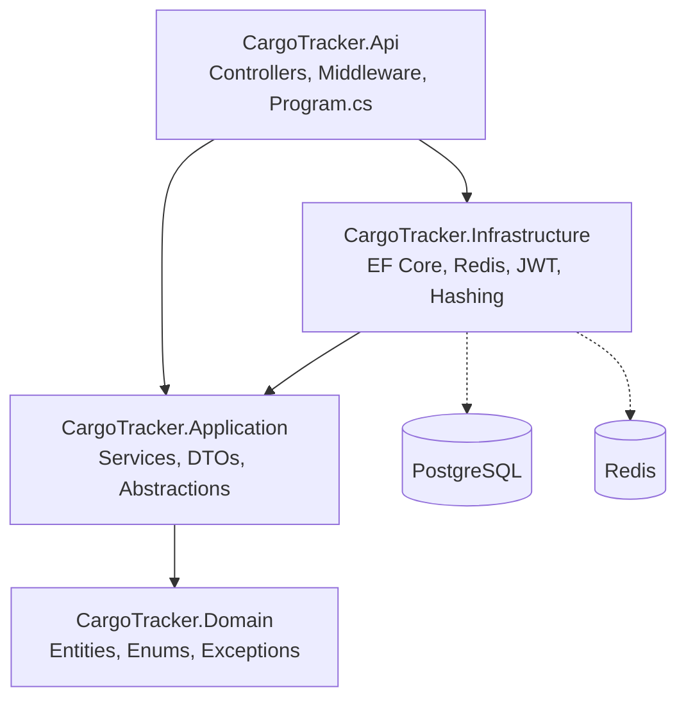
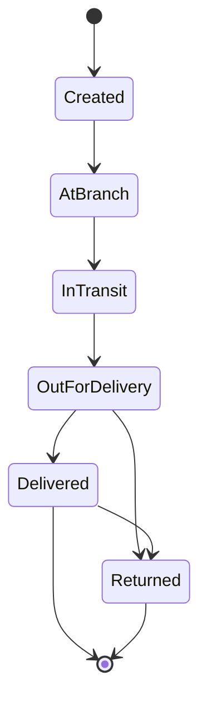

# cargo-tracker

[](https://github.com/berkturan04/cargo-tracker/actions/workflows/ci.yml)

Bir e-ticaret şirketinin siparişlerinin kargoya verilmesinden teslimata kadar durumunu takip eden,
rol bazlı yetkilendirmeye sahip bir REST API. Müşteri kendi kargosunu takip eder, kurye kendisine
atanan kargoların durumunu günceller, admin tüm sistemi yönetir.

## Durum
✅ 8 haftalık geliştirme tamamlandı

## Çalıştırma

**Tek komutla (önerilen):**
```bash
cp .env.example .env   # JWT_KEY, SEED_ADMIN_EMAIL, SEED_ADMIN_PASSWORD değerlerini doldur
docker compose up --build
```
API `http://localhost:8080/scalar` adresinde açılır, Admin bilgileriyle giriş yapıp deneyebilirsin.

**Geliştirme modunda (kod üzerinde çalışırken):**
```bash
docker compose up -d postgres redis
dotnet ef database update --project src/CargoTracker.Infrastructure --startup-project src/CargoTracker.Api
dotnet run --project src/CargoTracker.Api
```

**Testleri çalıştırmak için** (Docker Desktop açık olmalı, Testcontainers gerçek Postgres/Redis container'ları açıyor):
```bash
dotnet test
```

## Mimari

Katmanlı (Clean/Onion) mimari: bağımlılıklar her zaman içe, `Domain`'e doğru akar. `Domain`'in
hiçbir dış bağımlılığı yok, yani iş kurallarını veritabanı ya da web framework'ü olmadan test edebiliyoruz.



## Kargo durum akışı



Her geçiş `ShipmentStatusHistory` tablosuna (kim, ne zaman, hangi durumdan hangi duruma) kalıcı olarak kaydediliyor.

## Teknolojiler

- .NET 10 Web API, katmanlı mimari (Domain, Application, Infrastructure, Api)
- PostgreSQL + EF Core (code-first migration'lar)
- Redis (cache-aside deseni)
- JWT authentication, rol bazlı yetkilendirme (Admin, Courier, Customer)
- FluentValidation ile girdi doğrulama
- Merkezi hata yönetimi (`IExceptionHandler` + ProblemDetails/RFC 9457)
- Serilog ile yapılandırılmış loglama (konsol + dosya sink'leri)
- `BackgroundService` ile gecikmiş kargo tespiti ve bildirim simülasyonu
- xUnit (15 domain testi) + `WebApplicationFactory`/Testcontainers (10 entegrasyon testi)
- Docker (çok aşamalı build) + Docker Compose (api + postgres + redis)
- GitHub Actions ile CI

## API uç noktaları

| Metot | Yol | Yetki | Açıklama |
|---|---|---|---|
| POST | `/api/auth/register` | Herkese açık | Kayıt olur (her zaman Customer) |
| POST | `/api/auth/login` | Herkese açık | JWT token döner |
| GET | `/api/auth/me` | Giriş yapmış | Token içeriğini gösterir |
| POST | `/api/users` | Admin | Admin/Courier kullanıcı oluşturur |
| POST | `/api/shipments` | Customer, Admin | Yeni kargo oluşturur |
| GET | `/api/shipments/{trackingNumber}` | Giriş yapmış | Tek kargo (sahiplik kontrolü ile) |
| GET | `/api/shipments/mine` | Customer | Kendi kargolarım (filtre+sayfalama) |
| GET | `/api/shipments/assigned` | Courier | Bana atanan kargolar |
| GET | `/api/shipments` | Admin | Tüm kargolar (filtre+sayfalama) |
| PATCH | `/api/shipments/{trackingNumber}/status` | Courier, Admin | Durum günceller |
| PATCH | `/api/shipments/{trackingNumber}/courier` | Admin | Kurye atar |

Filtre/sayfalama parametreleri: `?status=&city=&fromDate=&toDate=&page=&pageSize=`

## Tasarım kararları

Bazı kararların arkasındaki gerekçe, özellikle gerçekten hata yapıp düzelttiğim yerler:

**Neden katmanlı mimari?**
`Domain` hiçbir projeye bağlı değil. Bu sayede `Shipment` gibi iş kurallarını (durum geçişleri, kurye atama kısıtları) veritabanı ya da HTTP olmadan, saf birim testlerle doğrulayabiliyorum.

**Neden başkasının kargosuna erişimde 403 değil 404?**
Müşteri başka bir müşterinin kargosunu sorgularsa 404 (yok) dönüyor, 403 (yetkisiz) değil — 403 demek "bu kaydın var olduğunu" doğrulamış olmak, bu da bir bilgi sızıntısı. Aynı mantığı login'de de kullandım: "e-posta yok" ile "şifre yanlış" için aynı mesaj.

**Peki kurye, kendine atanmamış bir kargoyu güncellemeye çalışınca neden 403?**
Çünkü kurye zaten `GET` ile o kargoyu görebiliyor (rolü kısıtlı değil), sadece durumunu değiştiremiyor. 404 yerine 403 kullanmak, "bu var ama senin değil" bilgisini doğru taşıyor — müşteri senaryosundaki gizlilik kaygısı burada geçerli değil.

**EF Core'da `ValueGeneratedNever()` neden gerekti?**
`Guid` birincil anahtarları kendim (`Guid.NewGuid()`) üretiyorum. Yeni bir `ShipmentStatusHistory` kaydını `DbSet.Add()` ile değil, bir navigation koleksiyonuna (`StatusHistory.Add(...)`) ekleyince, EF Core bunu "zaten var, güncelle" sanıp `INSERT` yerine `UPDATE` gönderiyordu — "0 satır etkilendi" hatası. `ValueGeneratedNever()`, EF Core'a anahtarı her zaman benim ürettiğimi söylüyor.

**FluentValidation neden otomatik değil, manuel çağrılıyor?**
`FluentValidation.AspNetCore`'un otomatik doğrulama entegrasyonu resmi olarak kullanımdan kaldırıldı (v12). Güncel tavsiye, validator'ı constructor'dan alıp controller'da elle çağırmak.

**Neden kendi exception tiplerim var, genel `InvalidOperationException` değil?**
Bir container'ı kapatıp veritabanı bağlantı hatası tetiklediğimde, EF Core bu hatayı `InvalidOperationException` ile sarmalıyordu — ve benim global hata işleyicim bunu yanlışlıkla "iş kuralı ihlali" (400) sanıp, bağlantı dizesi detaylarını içeren mesajı istemciye sızdırıyordu. Çözüm: kendi iş kurallarım için özel exception tipleri (`InvalidShipmentOperationException` gibi) tanımlamak, hiçbir zaman genel BCL tiplerine güvenmemek.

**Cache-aside'da sahiplik kontrolü neden cache'ten SONRA yapılıyor?**
Redis anahtarı sadece `trackingNumber`'a bağlı, hangi kullanıcının sorduğuna değil — böylece Admin, Courier ve kargonun sahibi Customer aynı cache kaydını paylaşıyor. Yetkisiz biri sorarsa cache'ten veri gelse bile son adımda `null` dönüyor, veri sızmıyor.

**Neden mock değil, gerçek Postgres/Redis container'larına karşı test (Testcontainers)?**
Sahte (in-memory) bir veritabanı, gerçek SQL davranışını (örneğin yukarıdaki `ValueGeneratedNever` hatasını) hiç yakalamazdı. Testcontainers, her test çalışmasında gerçek, geçici container'lar açıp kapatıyor.

## Proje yapısı

```
cargo-tracker/
├── src/
│   ├── CargoTracker.Domain/         # Entity'ler, enum'lar, domain exception'ları
│   ├── CargoTracker.Application/    # Servisler, DTO'lar, arayüzler
│   ├── CargoTracker.Infrastructure/ # EF Core, Redis, JWT, şifre hashleme
│   └── CargoTracker.Api/            # Controller'lar, middleware, Program.cs
├── tests/
│   ├── CargoTracker.Domain.Tests/        # xUnit birim testleri
│   └── CargoTracker.IntegrationTests/    # WebApplicationFactory + Testcontainers
├── .github/workflows/ci.yml
├── docker-compose.yml
└── src/CargoTracker.Api/Dockerfile
```